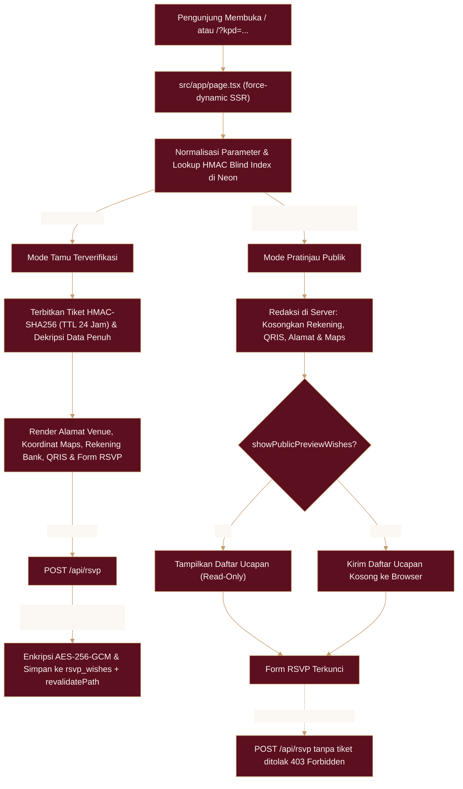
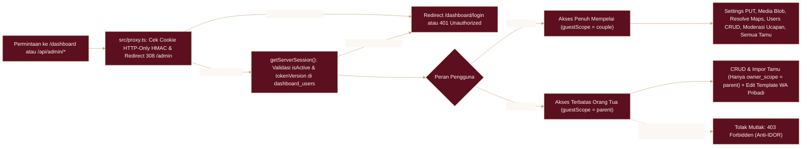
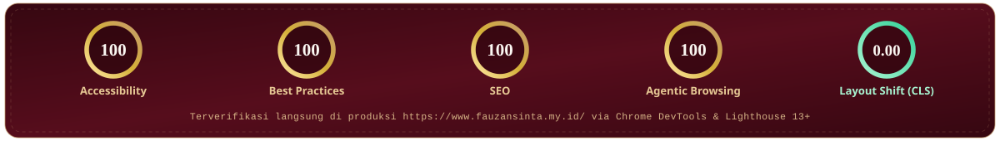

<div id="top" align="center">

<a href="https://www.fauzansinta.my.id/" target="_blank" rel="noopener noreferrer">
  
</a>

<br />

<picture>
  <source media="(prefers-color-scheme: dark)" srcset="https://readme-typing-svg.demolab.com?font=Cormorant+Garamond&weight=600&size=21&duration=3200&pause=1100&color=E6C894&center=true&vCenter=true&multiline=false&width=780&height=42&lines=Mode+Ketat+%3Fkpd%3D+dengan+Enkripsi+AES-256-GCM+%26+Blind+Index;Redaksi+Data+Privat+di+Sisi+Server+%26+Tiket+RSVP+HMAC-SHA256;Dashboard+Dual-Role%3A+Mempelai+(Admin)+%26+Keluarga+(Orang+Tua);Skor+Sempurna+100%2F100+Accessibility%2C+Best+Practices+%26+SEO" />
  
</picture>

<p>
  <a href="https://www.fauzansinta.my.id/"></a>
  
  
  
  
  
  
  
</p>

<p>
  <a href="#tentang-proyek">Tentang</a> &#183;
  <a href="#pratinjau-antarmuka">Pratinjau</a> &#183;
  <a href="#fitur-utama">Fitur Utama</a> &#183;
  <a href="#arsitektur--keamanan">Arsitektur &amp; Keamanan</a> &#183;
  <a href="#tech-stack">Tech Stack</a> &#183;
  <a href="#struktur-proyek">Struktur Proyek</a> &#183;
  <a href="#panduan-pengembangan-lokal">Panduan Lokal</a>
</p>

</div>


## Tentang Proyek

Aplikasi web undangan pernikahan digital adat Jawa untuk pernikahan Fauzan Ma'ruf dan Sinta Maria Utami (`#SINgkatceritaFAUZAN`) di Purbalingga, Jawa Tengah. Proyek ini dibangun di atas Next.js 16 App Router, React 19, Drizzle ORM, dan Neon Serverless PostgreSQL dengan fokus pada dua hal: penyajian antarmuka adat Jawa yang ringan di perangkat seluler serta perlindungan data pribadi keluarga di sisi server. Pengunjung umum yang membuka domain utama tanpa tautan tamu personal hanya menerima pratinjau publik yang telah disanitasi di server, sedangkan informasi rekening bank, QRIS, alamat lengkap lokasi, koordinat peta, dan hak kirim RSVP baru terbuka setelah parameter `?kpd=` lolos verifikasi Blind Index pada database.

---

## Pratinjau Antarmuka

<div align="center">

<a href="https://www.fauzansinta.my.id/" target="_blank" rel="noopener noreferrer">
  
</a>

<br />

<sub><b>Kartu Pratinjau Resmi (1200x630):</b> Aset lokal <code>public/images/og-wedding-preview.jpg</code> menggantikan sepenuhnya ketergantungan host eksternal untuk pratinjau tautan WhatsApp dan OpenGraph tanpa menampilkan alamat rumah, rekening, atau data tamu. <a href="https://www.fauzansinta.my.id/">Buka Mode Pratinjau Publik Live</a>.</sub>

</div>


## Fitur Utama

<table>
  <thead>
    <tr>
      <th width="50%">Halaman Undangan Publik</th>
      <th width="50%">Dashboard Operasional (Mempelai &amp; Orang Tua)</th>
    </tr>
  </thead>
  <tbody>
    <tr>
      <td valign="top">
        <ul>
          <li><b>Sampul <code>CoverGate</code> 4-Fase:</b> Membuka tirai undangan secara bertahap (<code>cover</code>, <code>opening</code>, <code>assets-entering</code>, <code>content-ready</code>) dengan sapaan tamu terpersonalisasi dari <code>?kpd=</code> dan cadangan aman <i>"Tamu Undangan"</i>.</li>
          <li><b>Pemutar Musik Latar Terpadu:</b> Daftar putar lagu preset maupun unggahan Vercel Blob dengan kontrol putar dan jeda otomatis saat tab peramban tidak aktif.</li>
          <li><b>Hitung Mundur <code>NumberFlow</code>:</b> Transisi digit numerik berformat <code>tabular-nums</code> menuju hari Akad dan Resepsi (Minggu, 3 Januari 2027), dilengkapi jadwal Tasyakuran (1–2 Januari 2027) dan tautan simpan ke Google Calendar.</li>
          <li><b>Mode Visual Terkunci:</b> Mengunci tampilan karakter pengantin Jawa atau foto asli langsung dari pengaturan admin di database, tanpa saklar pengubah di halaman tamu.</li>
          <li><b>Amplop Digital &amp; Modal QRIS Khusus Tamu:</b> Kartu rekening bank, dompet digital, alamat kirim kado, dan kode QRIS hanya dirender apabila parameter <code>?kpd=</code> terverifikasi sah.</li>
          <li><b>Buku Tamu RSVP Real-Time &amp; Empty State Bersih:</b> Formulir ucapan terlindung tiket HMAC-SHA256 dengan filter status kehadiran, pencarian pesan, kontrol visibilitas publik, dan kartu informasi bersih saat daftar ucapan masih kosong (tanpa <i>auto-reseed</i>).</li>
          <li><b>Halaman Kustom <code>404</code> &amp; <code>Error</code> Jawa Maroon:</b> Menjaga konsistensi visual kartu arch bermotif Truntum serta ikon aplikasi <code>apple-touch-icon.png</code>.</li>
        </ul>
      </td>
      <td valign="top">
        <ul>
          <li><b>2 Splash Screen Jawa (<code>access</code> &amp; <code>welcome</code>):</b> Transisi pembuka bernuansa Royal Maroon dan Gading dengan sapaan <i>"Sugeng rawuh"</i> yang menyesuaikan peran akun yang sedang masuk.</li>
          <li><b>Akses Dual-Role Terisolasi:</b> Memisahkan hak akses akun Mempelai (<code>admin</code>) untuk pengaturan penuh dengan akun Orang Tua (<code>parent</code>) yang difokuskan pada pengelolaan daftar tamu keluarga.</li>
          <li><b>Manajemen Daftar Tamu Terenkripsi:</b> Tambah kontak satuan, tambah massal berbasis teks, normalisasi nomor lokal ke format internasional <code>628xx</code>, serta pembaruan data aman (upsert) tanpa merusak token <code>slugQuery</code>.</li>
          <li><b>Impor &amp; Ekspor Spreadsheet <code>.xlsx</code> / <code>.csv</code>:</b> Memproses hingga 2.000 baris tamu per batch menggunakan SheetJS beserta sanitasi pencegahan formula injection.</li>
          <li><b>Pemisahan Template WhatsApp:</b> Menyediakan template pesan bawaan yang berbeda sudut pandang antara Mempelai (<i>"pernikahan kami"</i>) dan Orang Tua (<i>"pernikahan putra-putri kami"</i> + variabel dinamis <code>{pengirim}</code>).</li>
          <li><b>Antrean Kirim WhatsApp Web:</b> Mengirim pesan terarah ke satu tab peramban dengan jeda pengaman antar-tamu serta pencatatan waktu dan status terkirim otomatis.</li>
          <li><b>Kontrol Konten &amp; Moderasi Real-Time:</b> Mengatur jadwal acara, saklar visibilitas ucapan pada Mode Pratinjau Publik, moderasi buku tamu, unggah media/audio Vercel Blob, dan konversi koordinat Google Maps.</li>
        </ul>
      </td>
    </tr>
  </tbody>
</table>


## Arsitektur & Keamanan

### Alur Mode Ketat `?kpd=`, Redaksi Server & Tiket RSVP



### Isolasi RBAC & Scope Data Dashboard



<details>
<summary>🔐 Rincian Pertahanan Keamanan (OWASP Hardening)</summary>

<br />

| Lapisan Pertahanan | Implementasi di Kode | Lokasi Berkas |
| :--- | :--- | :--- |
| **Kriptografi Field & Blind Index** | Enkripsi terotentikasi AES-256-GCM (`enc:v1:iv:tag:cipher`) untuk nama tamu, nomor WhatsApp, kategori, rekening bank, alamat kado, dan pesan RSVP. Pencarian dan deduplikasi berjalan lewat HMAC-SHA256 Blind Index tanpa membuka plaintext seluruh kolom. | `src/lib/crypto.ts`, `src/lib/db/store.ts` |
| **Tiket Anti-Impersonation RSVP** | Setiap tamu terverifikasi menerima tiket bertanda tangan HMAC-SHA256 dengan domain separator khusus (`rsvp-ticket-v1:`) dan masa berlaku 24 jam. Endpoint `POST /api/rsvp` mengekstrak identitas pengirim langsung dari database tamu, bukan input bebas formulir, serta menerapkan batas 10 permintaan/menit per IP. | `src/lib/rsvpTicket.ts`, `src/app/api/rsvp/route.ts` |
| **Autentikasi, Rate Limit & Revocation** | Kata sandi akun dashboard di-hash memakai `crypto.scryptSync` dengan salt acak 16-byte dan perbandingan `timingSafeEqual`. Endpoint login membatasi 5 percobaan gagal per menit, dan pembaruan sandi atau penonaktifan akun otomatis menaikkan `tokenVersion` untuk mencabut sesi aktif. | `src/lib/auth.ts`, `src/lib/session.ts`, `src/app/api/admin/auth/route.ts`, `src/app/api/admin/users/route.ts` |
| **Proteksi SSRF Maps Resolver** | Endpoint `/api/admin/resolve-maps` hanya mengizinkan protokol `https://` menuju allowlist domain resmi Google Maps (`maps.app.goo.gl`, `goo.gl`, `maps.google.com`, `google.com`), mengikuti maksimal 3 hop redirect, dan memblokir `localhost`, IP privat/metadata (`169.254.x.x`), serta IPv6. | `src/app/api/admin/resolve-maps/route.ts` |
| **Verifikasi Biner Upload Media** | Unggahan gambar/audio ke Vercel Blob memeriksa tanda tangan magic-bytes asli (JPG, PNG, WebP, MP3, M4A, OGG, WAV), memindai payload poliglot (`<script`, `<?php`, `<svg`, header executable MZ/ELF), memblokir ekstensi berbahaya, dan membatasi ukuran maksimal (5 MB gambar, 15 MB audio). | `src/lib/fileSecurity.ts`, `src/app/api/admin/media/route.ts` |
| **Validasi Zod Ketat & Sanitasi Spreadsheet** | Skema permintaan HTTP memakai `.strict()` untuk menolak properti asing. Ekspor/impor CSV/Excel menetralkan awalan karakter rumus (`=`, `+`, `-`, `@`, tab) guna mencegah serangan spreadsheet formula injection. | `src/app/api/admin/settings/route.ts`, `src/app/api/admin/guests/import/route.ts`, `src/lib/phoneUtils.ts` |
| **HTTP Security Headers & Anti-Cache** | Header CSP, HSTS (`max-age=63072000; preload`), `X-Frame-Options: DENY`, `X-Content-Type-Options: nosniff`, `poweredByHeader: false`, serta header `Cache-Control: private, no-cache, no-store, max-age=0, must-revalidate` aktif pada endpoint privat agar data dinamis bebas cache basi. | `next.config.ts`, `src/proxy.ts`, `src/app/api/rsvp/route.ts`, `src/app/api/admin/guests/route.ts` |

</details>

<details>
<summary>📡 Peta API Endpoints</summary>

<br />

| Endpoint | Metode | Akses / Otorisasi | Fungsi Utama |
| :--- | :--- | :--- | :--- |
| `/api/rsvp` | `GET`, `POST` | Publik (`GET`, mengikuti saklar `showPublicPreviewWishes`), Tiket HMAC-SHA256 (`POST`) | Mengambil daftar ucapan terdekripsi dan menyimpan konfirmasi kehadiran baru dengan sanitasi XSS serta `revalidatePath`. |
| `/api/admin/auth` | `GET`, `POST`, `DELETE` | Publik (`POST`/`GET`), Terautentikasi (`DELETE`) | Pemeriksaan status sesi, login dashboard dengan rate limiting IP+username, dan penghapusan cookie sesi HTTP-only. |
| `/api/admin/guests` | `GET`, `POST`, `PATCH`, `DELETE` | Sesi Dashboard (`admin` / `parent` sesuai `guestScope`) | CRUD tamu satuan & massal, pencatatan status kirim WhatsApp, dengan blokir IDOR 403 lintas scope. |
| `/api/admin/guests/import` | `POST` | Sesi Dashboard (`admin` / `parent`) | Impor batch hingga 2.000 data tamu, normalisasi nomor telepon, dan sanitasi formula spreadsheet. |
| `/api/admin/media` | `GET`, `POST`, `PUT`, `DELETE` | Khusus `admin` | Manajemen galeri foto, konversi Data URL ke Vercel Blob, verifikasi magic-bytes unggahan multipart, dan penghapusan blob aman. |
| `/api/admin/profile/wa-template` | `GET`, `PATCH` | Sesi Dashboard | Membaca dan menyimpan template pesan WhatsApp personal per akun pengguna (mempelai maupun orang tua). |
| `/api/admin/resolve-maps` | `GET`, `POST` | Khusus `admin` | Mengekstrak koordinat latitude/longitude serta URL embed dari tautan pendek Google Maps secara aman dari SSRF. |
| `/api/admin/settings` | `GET`, `PUT` | Sesi Dashboard (`GET`), Khusus `admin` (`PUT`) | Membaca dan memperbarui konfigurasi acara, profil, rekening terenkripsi, mode visual, dan saklar fitur dengan Zod `.strict()`. |
| `/api/admin/users` | `GET`, `POST`, `PATCH`, `DELETE` | Khusus `admin` | Pembuatan dan pengelolaan akun dashboard orang tua/admin, pembaruan sandi, dan rotasi `tokenVersion`. |
| `/api/admin/wishes` | `GET`, `DELETE` | Khusus `admin` | Moderasi dan penghapusan baris ucapan di tabel `rsvp_wishes` beserta revalidasi halaman publik dan dashboard. |

</details>

<details>
<summary>🗄️ Skema Database (Drizzle ORM + Neon PostgreSQL)</summary>

<br />

Skema didefinisikan pada `src/lib/db/schema.ts` dan dikelola menggunakan Drizzle ORM (`@neondatabase/serverless`):

| Nama Tabel | Kolom & Informasi Utama | Indeks & Catatan Desain |
| :--- | :--- | :--- |
| `wedding_settings` | Identitas kedua mempelai, jadwal Tasyakuran (`tasyakuran_start_date`, `tasyakuran_end_date`), tanggal Akad/Resepsi, lokasi terenkripsi (`venue_address`, `google_maps_*`), data amplop terenkripsi (`bank_accounts`, `ewallets`, `gift_address`), saklar visual (`couple_visual_mode`, `svg_character_preset`, `is_gallery_enabled`, `is_love_story_enabled`, `show_public_preview_wishes`). | Baris tunggal konfigurasi aktif aplikasi; mutasi diizinkan khusus akun `admin`. |
| `guests` | Data tamu terenkripsi AES-256-GCM (`name`, `whatsapp_number`, `category`), `slug_query`, blind index pencarian (`name_bindex`, `wa_bindex`), status WhatsApp (`wa_sent_status`, `wa_sent_at`), dan isolasi pemilik (`owner_scope`, `created_by`). | Indeks pada `slug_query`, `name_bindex`, `wa_bindex`, dan `owner_scope`. |
| `rsvp_wishes` | Nama tamu terenkripsi (`guest_name`), status kehadiran (`attendance_status`), jumlah tamu (`pax_count`), pesan doa terenkripsi (`message`), flag moderasi (`is_approved`), dan `created_at`. | Indeks pada `created_at` dan `is_approved`. |
| `gallery_photos` | `image_url`, `caption`, `aspect_ratio`, `sort_order`, `created_at`. | Menyimpan tautan gambar Vercel Blob dan aset galeri. |
| `guest_tokens` | `code` (PK, `varchar(12)`), `guest_name`, `created_at`. | Pemetaan kode singkat undangan ke nama tamu. |
| `music_tracks` | `slug` (unique), `title`, `artist`, `url`, `is_active`, `created_at`. | Indeks pada `slug` dan `is_active` untuk daftar putar musik latar. |
| `dashboard_users` | `username` (unique), `password_hash` (scrypt), `role` (`admin` / `parent`), `display_name`, `guest_scope`, `wa_template`, `is_active`, `token_version`. | Indeks pada `username` dan `role`; mendukung pencabutan sesi instan lewat `token_version`. |

</details>


## Skor Kualitas Produksi & Tech Stack

<div align="center">
  
</div>

Audit live di `https://www.fauzansinta.my.id/` (Chrome DevTools & Lighthouse 13+ pada Mobile `375x812` dengan pembatasan CPU 4x serta Desktop `1440x900`) mencatat **54 dari 54 audit lulus** untuk kategori Accessibility, Best Practices, SEO, dan Agentic Browsing dengan `CLS 0.00` dan `0` console error. Performa dimaksimalkan lewat *deferred mounting* 11 komponen bawah layar di balik `CoverGate` (`requestIdleCallback` + `next/dynamic`), *preload* aset penting (`react-dom` `preload` pada rute publik `/` dan `fetchPriority="high"` pada segel LCP), serta kompresi 7 aset WebP Jawa sebesar 56,2% (menghemat sekitar 624 KB).

<br />

<div align="center" id="tech-stack">
  <picture>
    <source media="(prefers-color-scheme: dark)" srcset="https://skillicons.dev/icons?i=nextjs,react,ts,tailwind,postgres,vercel,git&theme=dark" />
    
  </picture>
</div>

<br />

| Kategori | Paket / Teknologi | Versi (`package.json`) | Peran dalam Sistem |
| :--- | :--- | :--- | :--- |
| **Framework & Runtime** | `next`, `react`, `react-dom` | `16.4.6`, `19.3.1` | App Router SSR/CSR, Route Handlers, `proxy.ts`, `react-dom` `preload`, dan error boundary kustom. |
| **Bahasa & Validasi** | `typescript`, `zod` | `7.0.2`, `4.6.7` | Pengetikan statis penuh dan validasi skema API `.strict()`. |
| **Styling & Aksesibilitas** | `tailwindcss`, `@tailwindcss/postcss`, `@radix-ui/react-*`, `lucide-react` | `4.3.5`, `1.x–2.x`, `1.77.0` | Konfigurasi Tailwind CSS v4 CSS-first (`@theme`), primitif dialog/switch/select aksesibel, dan ikon vektor. |
| **Database & Storage** | `@neondatabase/serverless`, `drizzle-orm`, `@vercel/blob` | `1.2.1`, `0.45.4`, `2.9.0` | Driver HTTP & Pool Neon PostgreSQL serverless, query bertipe aman, serta penyimpanan gambar dan audio. |
| **Komponen Interaktif & Spreadsheet** | `@number-flow/react`, `sonner`, `react-virtuoso`, `canvas-confetti`, `xlsx` | `0.6.2`, `2.0.8`, `4.18.24`, `1.9.4`, `0.18.5` | Animasi digit hitung mundur, toast notifikasi, daftar tervirtualisasi, efek selebrasi, serta impor/ekspor Excel dan CSV. |


## Struktur Proyek

<details>
<summary>📁 Peta Direktori Repositori</summary>

```text
UndanganDigital/
├── docs/
│   └── readme/                        # Aset vektor SVG animasi untuk README
│       ├── hero-javanese.svg
│       ├── divider-gunungan.svg
│       ├── quality-metrics.svg
│       └── footer-javanese.svg
├── public/
│   ├── apple-touch-icon.png           # Ikon home screen iOS/macOS
│   ├── assets/javanese/               # Aset ilustrasi & ornamen WebP terkompresi
│   └── images/                        # SVG motif Truntum, segel emas, karakter & OG image 1200x630
├── src/
│   ├── app/
│   │   ├── api/
│   │   │   ├── admin/                 # auth, guests (+ import), media, profile/wa-template, resolve-maps, settings, users, wishes
│   │   │   └── rsvp/route.ts          # Endpoint RSVP publik (force-dynamic & anti-cache)
│   │   ├── admin/                     # Redirect 308 rute lama ke /dashboard
│   │   ├── dashboard/                 # Ruang operasional Mempelai & Orang Tua + login
│   │   ├── error.tsx                  # Error boundary kustom bertema Jawa Maroon
│   │   ├── not-found.tsx              # Halaman 404 kustom bertema Jawa Maroon
│   │   ├── page.tsx                   # SSR halaman undangan publik (Strict Mode ?kpd= & redaksi)
│   │   ├── robots.ts & sitemap.ts     # Pengaturan crawling mesin pencari
│   │   ├── globals.css & layout.tsx   # Token desain Tailwind v4 & Google Fonts
│   ├── components/
│   │   ├── admin/                     # DashboardWorkspace, 2 SplashScreen Jawa, modul tamu/media/wishes/settings
│   │   ├── invitation/                # CoverGate, CountdownHero, CoupleProfile, EventDetails, DigitalEnvelope, RsvpGuestbook, dll.
│   │   └── ui/                        # Komponen dasar Radix & CVA
│   ├── db/schema.ts                   # Re-ekspor skema Drizzle
│   ├── hooks/useParallax.ts           # Deteksi prefers-reduced-motion & hook gerak
│   ├── lib/
│   │   ├── db/                        # Koneksi Neon serverless, schema 7 tabel, store terenkripsi, seed data
│   │   ├── auth.ts & session.ts       # Autentikasi scrypt, HMAC cookie, rate limit & revocation
│   │   ├── crypto.ts                  # Enkripsi AES-256-GCM & HMAC Blind Index
│   │   ├── rsvpTicket.ts              # Penandatanganan & verifikasi tiket RSVP
│   │   ├── guestTemplate.ts           # Pemisahan template WA Mempelai vs Orang Tua + SheetJS import/export
│   │   ├── fileSecurity.ts            # Validasi magic-bytes & pemindaian payload poliglot
│   │   └── guestUtils.ts, guestValidator.ts, phoneUtils.ts, urlUtils.ts, dateFormat.ts, splashTransition.ts
│   └── proxy.ts                       # Proteksi rute /dashboard & /api/admin serta injeksi HTTP security headers
├── drizzle.config.ts
├── next.config.ts                     # Konfigurasi gambar & header Content-Security-Policy
├── package.json
└── tsconfig.json
```

</details>

## Panduan Pengembangan Lokal

<details>
<summary>⚙️ Variabel Lingkungan (.env.local)</summary>

Buat berkas `.env.local` pada root proyek (seluruh berkas `.env*` diabaikan Git). Gunakan nilai acak yang kuat untuk kunci rahasia dan jangan pernah membagikan kredensial asli ke repositori:

```env
# URL Aplikasi Publik
NEXT_PUBLIC_APP_URL="http://localhost:3000"
NEXT_PUBLIC_SITE_URL="http://localhost:3000"

# Koneksi Neon PostgreSQL (Wajib SSL)
DATABASE_URL="<isi-url-postgres-pooler-dengan-sslmode-require>"
DATABASE_URL_UNPOOLED="<isi-url-postgres-direct-dengan-sslmode-require>"

# Penyimpanan Media & Audio Vercel Blob
BLOB_READ_WRITE_TOKEN="<isi-token-vercel-blob>"

# Akun Cadangan Admin & Kunci Sesi
ADMIN_USERNAME="admin"
ADMIN_PASSWORD_HASH="<isi-sha256-password-admin>"
SESSION_SECRET="<isi-secret-32-byte>"

# Kunci Enkripsi Data Tamu & Blind Index (Minimal 32 Karakter)
ENCRYPTION_KEY="<isi-encryption-key-32-byte>"
BLIND_INDEX_SECRET="<isi-blind-index-secret-32-byte>"
```

</details>

<details>
<summary>🚀 Menjalankan Proyek Secara Lokal</summary>

1. **Klon repositori dan pasang dependensi** (disarankan Node.js 20+):
   ```bash
   git clone https://github.com/Smurffahh/UndanganDigital.git
   cd UndanganDigital
   npm install
   ```

2. **Sinkronkan skema Drizzle ORM ke database PostgreSQL**:
   ```bash
   npx drizzle-kit push
   ```

3. **Jalankan server pengembangan lokal**:
   ```bash
   npm run dev
   ```
   Akses pratinjau publik di `http://localhost:3000/` dan login dashboard di `http://localhost:3000/dashboard/login`.

4. **Verifikasi build produksi dan linter**:
   ```bash
   npm run lint
   npm run build
   npm run start
   ```

</details>

> [!IMPORTANT]
> Di lingkungan produksi, aplikasi dikonfigurasi dengan `export const dynamic = "force-dynamic"` serta header `Cache-Control: private, no-cache, no-store, max-age=0, must-revalidate` pada rute dinamis agar halaman undangan tidak menyajikan data basi atau membocorkan konten tamu antar-pengunjung di lapisan CDN. Disarankan menjalankan `DATABASE_URL` aplikasi dengan peran PostgreSQL *least-privilege* khusus runtime (seperti peran `app_runtime` tanpa hak `DROP`/`TRUNCATE`) sementara `DATABASE_URL_UNPOOLED` milik owner hanya digunakan saat menjalankan migrasi skema lewat `npx drizzle-kit push`.

<br />

<div align="center">
  
  <br />
  <a href="#top">Kembali ke atas &#8593;</a>
</div>
